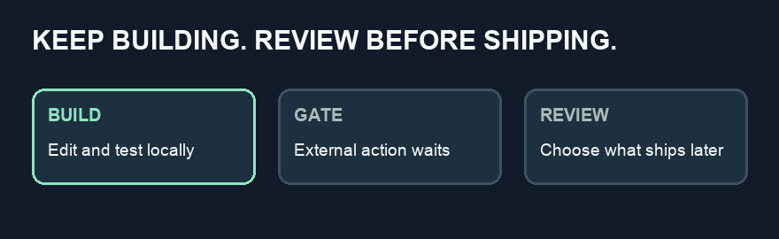

<p align="center"></p>

# SoberGate

**Build freely. Ship sober.**

SoberGate is an open-source experiment by Syntax Error Pvt Ltd that helps you defer high-impact actions while you continue local work. No account, telemetry, health monitoring, or intoxication detection.

> **Early prototype — not yet safe for agent use.** `sg lock` does not automatically protect your terminal or agent. Only commands submitted to `sg exec` or the included minimal command prompt are filtered. Scripts, git hooks, MCP, native agent tools, browsers, other shells and direct network access can bypass it. Do not use it as your production safety boundary. See the [threat model](docs/THREAT_MODEL.md).



## Try it safely

Requires Node.js 20+. This does not install or change an agent, your shell profile, or global configuration.

```sh
git clone https://github.com/sintaxerrorpvtltd/sobergate.git
cd sobergate
npm test
export SOBERGATE_HOME="$(mktemp -d)"   # disposable demo state
node bin/sg.js lock 10h
node bin/sg.js exec -- git status
node bin/sg.js exec -- git push
node bin/sg.js exec -- railway up
node bin/sg.js review
```

Optionally install the package locally (`npm install -g .`) for `sg` and `sobergate` commands. Installing does not configure an agent or protect other terminals. `sg shell` starts a deliberately minimal prompt; it supports one direct command per line, not shell operators, variables, pipelines or scripts. Type `exit` to leave.

Modes: `sg lock 10h` (also `--for 10h`) activates a timed lock, `sg guard` selects conservative guard mode, `sg clear` returns to clear when no lock is active, and `sg status` displays the state. An active lock can be extended, never shortened by these commands. On expiry it changes to CLEAR when next checked. The state is not tamper-resistant.

In LOCKED or GUARD, known local commands can run and other commands are denied and recorded as reminders. GUARD confirmation is not implemented yet. `sg review` displays reminders and `sg discard ID` removes one after the lock expires. Arguments are not stored, so review is not a replay queue; run any desired action yourself after inspecting it. Nothing runs automatically.

## Scope

This prototype deliberately blocks interpreters, package managers, cloud CLIs and unclassified commands in its prompt, including local tests; use a separate sandbox for development. Allowed commands can still indirectly execute external actions. The agent adapters are design notes, not working integrations. There is no daemon, provider identity detection, pre-push hook, network sandbox, secret protection, or system-wide enforcement. It has only been tested in disposable local directories, not an isolated VM.

## Contributing

See [CONTRIBUTING.md](CONTRIBUTING.md), [SECURITY.md](SECURITY.md) and [the threat model](docs/THREAT_MODEL.md). Apache-2.0 licensed. Copyright 2026 Syntax Error Pvt Ltd and contributors.
